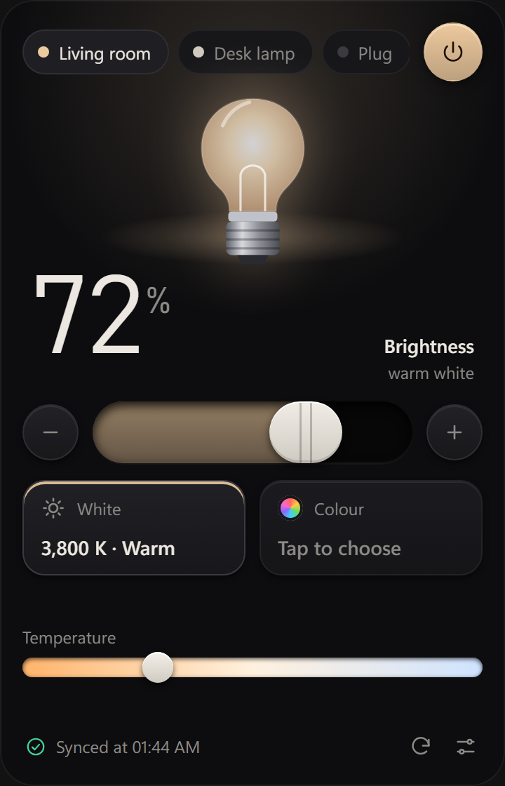
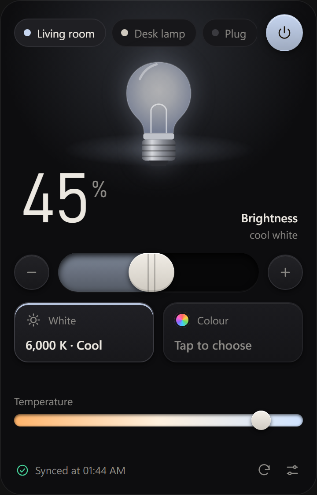
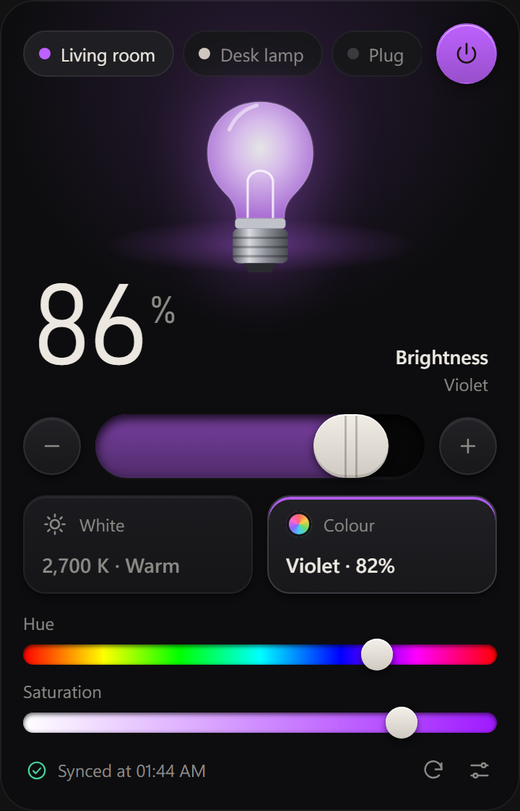
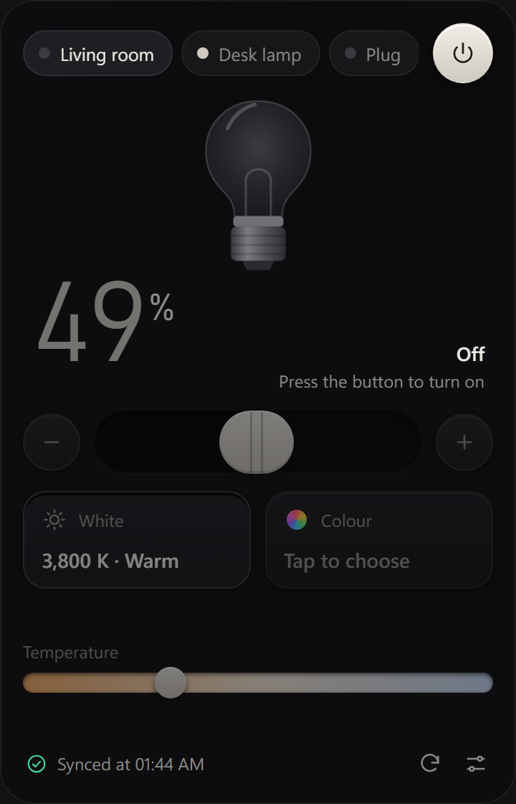
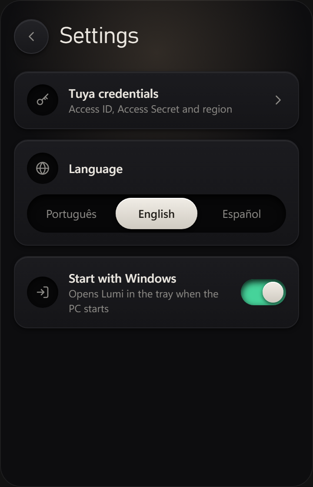
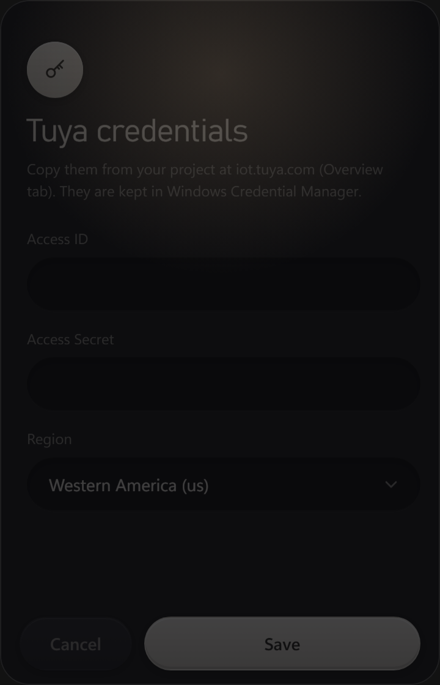

<div align="center">


# Lumi

**Control your smart lights right from the Windows tray.**

One click on the icon, the light changes. No phone needed.




</div>

## What it is

Lumi is a Windows tray app that controls **Tuya** smart devices through the cloud. The popup opens next to the clock, shows one device at a time and always reflects the lamp's real state.

## Features

- **Brightness, temperature and colour** with tactile sliders. The light's colour tints the whole window.
- **The lamp illustration follows the brightness** and colour you set, with smooth transitions.
- **Multiple devices**: switch between them with the pills at the top, and turn them on or off with one button.
- **Always-true state**: refreshes automatically every 10 s and clearly shows synced, updating or error.
- **Three languages**: Português, English and Español, including the tray menu.
- **Start with Windows** behind a single switch.
- **Safe credentials**: stored in Windows Credential Manager, never in a file.

## Screenshots

<table>
  <tr>
    <td align="center"><br/><sub>Warm white</sub></td>
    <td align="center"><br/><sub>Cool white</sub></td>
    <td align="center"><br/><sub>Colour</sub></td>
  </tr>
  <tr>
    <td align="center"><br/><sub>Off</sub></td>
    <td align="center"><br/><sub>Settings</sub></td>
    <td align="center"><br/><sub>Tuya credentials</sub></td>
  </tr>
</table>

## How it works

Lumi talks to the **Tuya cloud API**. There is no local protocol and no `local_key`.

1. Pair your devices in the **Smart Life** app (some white-label vendor apps do not let you link their account to a Tuya IoT project).
2. On [iot.tuya.com](https://iot.tuya.com), create a project and link your Smart Life account (*Devices → Link App Account*).
3. Enable the **IoT Core**, **Authorization Token Management** and **Smart Home Basic Service** APIs.
4. Open Lumi and enter the project's **Access ID**, **Access Secret** and region.

## Development

Requirements: [Rust](https://rustup.rs), [Node.js](https://nodejs.org) and the Windows WebView2 runtime.

```bash
cd app
npm install
npm run tauri dev
```

Tests:

```bash
npm test                      # UI (Vitest)
cd src-tauri && cargo test    # Rust core
```

Build the installer:

```bash
npm run tauri build
```

## Project layout

| Folder | Contents |
| --- | --- |
| `app/src` | UI built with SvelteKit and Svelte 5 |
| `app/src-tauri` | Rust core: Tuya client, tray, credentials |
| `docs` | Spec, plan and screenshots (Portuguese) |
| `spike` | Python scripts used to explore the Tuya API |

## Disclaimer

Independent project, not affiliated with Tuya.
